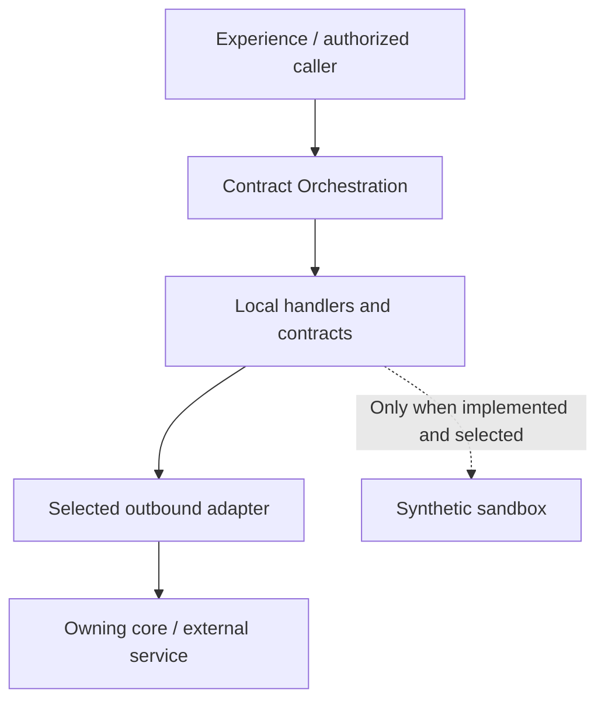

<a href="https://fireflysoftware.io/openplatform/">
<picture>
  <source media="(max-width: 640px) and (prefers-color-scheme: dark)" srcset="https://raw.githubusercontent.com/fireflysoftwaresolutions/.github/main/profile/assets/banner-narrow-dark.svg">
  <source media="(max-width: 640px)" srcset="https://raw.githubusercontent.com/fireflysoftwaresolutions/.github/main/profile/assets/banner-narrow-light.svg">
  <source media="(prefers-color-scheme: dark)" srcset="https://raw.githubusercontent.com/fireflysoftwaresolutions/.github/main/profile/assets/banner-dark.svg">
  
</picture>
</a>

# Contract Orchestration

Domain service for contract registration, updates, lifecycle operations, and document coordination in Firefly OpenPlatform.

[Platform documentation](https://docs.fireflysoftware.io/) · [Source reference](docs/openplatform/reference.md) · [Source inventory](docs/openplatform/source-inventory.json)

## Purpose, scope, and readiness

This repository owns the contract registration, updates, lifecycle operations, and document coordination boundary. Public DTOs and local ports define the contract; configured adapters connect it to the services that own the underlying records. The exact implemented surface is listed below.

The current source contains the declarations indexed in the companion reference. Functional readiness is bounded by the implemented handlers, adapters, and tests; this guide does not elevate a record API, sample provider, or unexecuted test into a completed business journey.

## Business ownership and supported journeys

Compose contract management and document services so the agreement workflow can keep its data and issued document references together.

Document creation is not signature completion. Preserve intermediate identifiers and inspect saga compensation before declaring an agreement active.

| Entry point | Declared operations |
| --- | --- |
| [ContractController](domain-common-contracts-web/src/main/java/io/fireflysoftware/domain/common/contracts/web/controllers/ContractController.java) | `GET /api/v1/contracts/{contractId}`; `GET /api/v1/contracts/by-party/{partyId}`; `GET /api/v1/contracts/by-party/{partyId}/active`; 5 more declarations |
| [ContractDocumentController](domain-common-contracts-web/src/main/java/io/fireflysoftware/domain/common/contracts/web/controllers/ContractDocumentController.java) | `GET /api/v1/contracts/{contractId}/documents`; `GET /api/v1/contracts/{contractId}/documents/{docId}`; `POST /api/v1/contracts/{contractId}/documents/generate` |
| [ContractPartyController](domain-common-contracts-web/src/main/java/io/fireflysoftware/domain/common/contracts/web/controllers/ContractPartyController.java) | `GET /api/v1/contracts/{contractId}/parties`; `POST /api/v1/contracts/{contractId}/parties`; `DELETE /api/v1/contracts/{contractId}/parties/{partyId}` |
| [ContractSignatureController](domain-common-contracts-web/src/main/java/io/fireflysoftware/domain/common/contracts/web/controllers/ContractSignatureController.java) | `POST /api/v1/contracts/{contractId}/signature/request`; `POST /api/v1/contracts/{contractId}/signature/confirm` |
| [ContractTermsController](domain-common-contracts-web/src/main/java/io/fireflysoftware/domain/common/contracts/web/controllers/ContractTermsController.java) | `GET /api/v1/contracts/{contractId}/terms`; `POST /api/v1/contracts/{contractId}/terms` |
| [KitDocumentsController](domain-common-contracts-web/src/main/java/io/fireflysoftware/domain/common/contracts/web/controllers/KitDocumentsController.java) | `GET /api/v1/kit-documents/{id}` |
| [GovernedContractDocumentController](domain-common-contracts-web/src/main/java/io/fireflysoftware/domain/common/contracts/web/controllers/document/v1/GovernedContractDocumentController.java) | `GET /api/v1/tenants/{tenantId}/contracts/{contractId}/governed-documents/{actionId}`; `GET /api/v1/tenants/{tenantId}/contracts/{contractId}/governed-documents/{actionId}/content`; `POST /api/v1/tenants/{tenantId}/contracts/{contractId}/governed-documents`; 1 more declarations |

The complete [operation reference](docs/openplatform/reference.md#http-operations) lists each mapping and its owning method. These are source declarations; conditional beans, inherited controllers, security filters, and deployment routing can change the effective runtime API.

## Consumer example: reuse the authoritative signature request ID

Start with this repository-owned executable contract before connecting a full runtime. Use the JDK required by the effective parent, Maven, and the matching internal artifacts. The selected test defines its own collaborators; no provider credentials should be added to it. Run from this repository root:

```sh
mvn -B -pl domain-common-contracts-core -am test -DskipOpenApiGen \
  -Dtest=RequestSignatureSagaTest -Dsurefire.failIfNoSpecifiedTests=false
```

Runtime integration remains gated on the service configuration and selected adapters described below. The local port and bean-selection inventory below distinguishes the declared abstraction from its configured implementation. An SDK client is an outbound integration; its presence does not establish a working provider connection. Where a sandbox adapter is selected, its behavior is synthetic and limited to what that adapter implements.

**Inputs and fixture ownership.** The complete linked test class supplies its imports, setup, synthetic IDs and collaborators. Run that class as shown; the excerpt is not a standalone Java program. The full fixture supplies mocked collaborators; inspect its setup before changing the boundary. Synthetic adapter data is scoped to this fixture and does not seed an external owner. For a deployed call, replace fixture IDs with IDs returned by the owning record-creation API and keep tenant/parent associations intact. The request values and assertions below describe this test boundary only.

```java
@Test
    void execute_returnsTheDurableRequestIdWithoutCreatingAnotherCoreRecord() {
        UUID contract=UUID.randomUUID(),document=UUID.randomUUID(),signer=UUID.randomUUID(),id=UUID.randomUUID();
        var cmd=new RequestContractSignatureCommand(contract,document,signer);
        when(eSignaturePort.requestSignature(any())).thenReturn(Mono.just(SignatureRequestResult.builder()
                .signatureRequestId(id.toString()).provider("sandbox").status("PENDING").build()));
        when(contractStatusHistoryApi.createContractStatusHistory(eq(contract),any(),any()))
                .thenReturn(Mono.just(new ContractStatusHistoryDTO(UUID.randomUUID(),null,null)));
        var inputs=StepInputs.builder().forStepId("create-signature-request",cmd).forStepId("send-to-provider",cmd)
                .forStepId("update-contract-status",cmd).build();
        StepVerifier.create(sagaEngine.execute("request-signature-saga",inputs)).assertNext(result -> {
            assertThat(result.isSuccess()).isTrue();
            assertThat(result.resultOf("create-signature-request",UUID.class)).contains(id);
        }).verifyComplete();
        verify(documentSignatureControllerApi,never()).addDocumentSignature(any(),any(),any());
        verify(eSignaturePort).requestSignature(any());
    }
```

**Expected behavior.** The saga returns the durable request ID supplied by the signature boundary and does not create a second document-signature row. Real signing requires an issued document associated with the contract, signer and tenant.

**Verification and recovery.** Run the complete selected test class and inspect its Surefire result: zero failures/errors and at least one executed test are required. A skipped or zero-test build is not evidence. Compare the assertions with the owning DTO/service before extending the request. For a runtime run, separately configure authentication/entitlements and the exact downstream endpoints, migrate/seed disposable owner stores, and reread the returned identifier; these unit/contract fixtures do not establish those prerequisites.

**Execution evidence.** Source checked against the linked test and local declarations. The documentation worker has not run this repository test or the full service. The excerpt is retained from the existing test; mock, in-memory, or local HTTP fixture results are not live-provider acceptance.

Source of this example: [RequestSignatureSagaTest](domain-common-contracts-core/src/test/java/io/fireflysoftware/domain/common/contracts/core/workflows/RequestSignatureSagaTest.java), [RequestContractSignatureCommand](domain-common-contracts-core/src/main/java/io/fireflysoftware/domain/common/contracts/core/commands/RequestContractSignatureCommand.java), [ESignaturePort](domain-common-contracts-infra/src/main/java/io/fireflysoftware/domain/common/contracts/infra/ports/ESignaturePort.java), [SignatureRequestResult](domain-common-contracts-infra/src/main/java/io/fireflysoftware/domain/common/contracts/infra/ports/model/SignatureRequestResult.java).

## Architecture and repository layout



| Module | Responsibility |
| --- | --- |
| [domain-common-contracts-core](domain-common-contracts-core/) | Application services, handlers, and business coordination; inspect these implementations for lifecycle rules. |
| [domain-common-contracts-interfaces](domain-common-contracts-interfaces/) | Public DTOs, commands, queries, and contracts shared across the module boundary. |
| [domain-common-contracts-web](domain-common-contracts-web/) | HTTP entry points, boot application, and runtime configuration. |
| [domain-common-contracts-sdk](domain-common-contracts-sdk/) | Client artifact and OpenAPI generation configuration; build it from the matching service contract. |
| [domain-common-contracts-infra](domain-common-contracts-infra/) | Outbound clients, adapters, and client configuration for dependencies. |

## Contracts, data, authentication, and errors

DocumentManagementESignatureAdapter calls the exact generated document-core SDK for submission and verification. It validates returned request, contract, document, intended signer, tenant, provider, and synthetic provenance against the current context; the core retains the durable association and provider lifecycle. RequestSignatureSaga returns the persisted submission UUID needed by confirmation rather than a status-history ID. Failed compensation preserves provider evidence.

ConfirmSignatureSaga requires exact VERIFIED status, matching nonblank request ID, provider identity, and the expected contract/document/signer association before approval history or signed events. Pending, rejected, expired, unknown, mismatched, and unsupported synthetic results cannot approve a contract. The core-backed synthetic lifecycle survives pending and completed core process restarts in qualification. Trusted authenticated live context, immutable document content/version/hash, complete real provider request/envelope support, callbacks, and full contract-journey acceptance remain separate required work.

| Data type | Declared fields (selection) |
| --- | --- |
| [AddContractPartyCommand](domain-common-contracts-core/src/main/java/io/fireflysoftware/domain/common/contracts/core/commands/AddContractPartyCommand.java) | `contractId`, `partyId`, `role` |
| [AddContractTermsCommand](domain-common-contracts-core/src/main/java/io/fireflysoftware/domain/common/contracts/core/commands/AddContractTermsCommand.java) | `contractId`, `termTemplateId`, `termValue` |
| [ChangeContractStatusCommand](domain-common-contracts-core/src/main/java/io/fireflysoftware/domain/common/contracts/core/commands/ChangeContractStatusCommand.java) | `contractId`, `status`, `reason` |
| [ConfirmContractSignatureCommand](domain-common-contracts-core/src/main/java/io/fireflysoftware/domain/common/contracts/core/commands/ConfirmContractSignatureCommand.java) | `contractId`, `signatureRequestId` |
| [GenerateContractDocumentCommand](domain-common-contracts-core/src/main/java/io/fireflysoftware/domain/common/contracts/core/commands/GenerateContractDocumentCommand.java) | `contractId`, `templateId` |
| [RemoveContractCommand](domain-common-contracts-core/src/main/java/io/fireflysoftware/domain/common/contracts/core/commands/RemoveContractCommand.java) | `contractId` |
| [RemoveContractLineCommand](domain-common-contracts-core/src/main/java/io/fireflysoftware/domain/common/contracts/core/commands/RemoveContractLineCommand.java) | `contractId`, `contractLineId` |
| [RemoveContractPartyCommand](domain-common-contracts-core/src/main/java/io/fireflysoftware/domain/common/contracts/core/commands/RemoveContractPartyCommand.java) | `contractId`, `partyId` |
| [RemoveContractStatusHistoryCommand](domain-common-contracts-core/src/main/java/io/fireflysoftware/domain/common/contracts/core/commands/RemoveContractStatusHistoryCommand.java) | `contractId`, `contractStatusHistoryId` |
| [RequestContractSignatureCommand](domain-common-contracts-core/src/main/java/io/fireflysoftware/domain/common/contracts/core/commands/RequestContractSignatureCommand.java) | `contractId`, `documentId`, `signerPartyId` |
| [RequestContractSignatureHandler](domain-common-contracts-core/src/main/java/io/fireflysoftware/domain/common/contracts/core/handlers/RequestContractSignatureHandler.java) | `sagaEngine` |
| [RequestSignatureSaga](domain-common-contracts-core/src/main/java/io/fireflysoftware/domain/common/contracts/core/workflows/RequestSignatureSaga.java) | `eSignaturePort`, `contractStatusHistoryApi` |

The [data contract reference](docs/openplatform/reference.md#data-contracts) indexes **16 DTO, record, or entity declarations** and their fields. Read DTO validation annotations together with service logic and migrations; a field's presence does not establish that every endpoint accepts it.

Use the authentication and authorization behavior actually enforced by the deployed entry point. Tenant, party, distributor, and staff identifiers carry business scope; they must not be accepted as proof of identity. Preserve validation and downstream errors rather than mapping an unavailable dependency to a successful business result.

Examples of locally enforced failure or access behavior:

| Declared check or failure | Implementation |
| --- | --- |
| `new ResponseStatusException(HttpStatus.CONFLICT, "GOVERNED_DOCUMENT_INTENT_REQUIRED");` | [LegacyDocumentMigration](domain-common-contracts-core/src/main/java/io/fireflysoftware/domain/common/contracts/core/documents/LegacyDocumentMigration.java) |
| `new ResponseStatusException(` | [GovernedPeerEndpoint](domain-common-contracts-infra/src/main/java/io/fireflysoftware/domain/common/contracts/infra/documents/v1/GovernedPeerEndpoint.java) |
| `new ResponseStatusException(HttpStatus.BAD_GATEWAY, "GOVERNED_DOCUMENT_PEER_INVALID");` | [SealedContractDocumentRequest](domain-common-contracts-core/src/main/java/io/fireflysoftware/domain/common/contracts/core/documents/v1/SealedContractDocumentRequest.java) |
| `new ResponseStatusException(HttpStatusCode.valueOf(code), reason);` | [GovernedContractDocumentCoordinator](domain-common-contracts-core/src/main/java/io/fireflysoftware/domain/common/contracts/core/documents/v1/GovernedContractDocumentCoordinator.java) |
| `new ResponseStatusException(HttpStatus.FORBIDDEN, "GOVERNED_DOCUMENT_ACCESS_DENIED");` | [GovernedDocumentAccessGuard](domain-common-contracts-core/src/main/java/io/fireflysoftware/domain/common/contracts/core/documents/v1/GovernedDocumentAccessGuard.java) |
| `new ResponseStatusException(HttpStatus.BAD_REQUEST, "GOVERNED_DOCUMENT_INTENT_INVALID");` | [GovernedContractDocumentInputs](domain-common-contracts-web/src/main/java/io/fireflysoftware/domain/common/contracts/web/documents/v1/GovernedContractDocumentInputs.java) |

The [security and failure reference](docs/openplatform/reference.md#security-and-failure-evidence) links local authorization annotations, status mappings, and exception sites. Framework or gateway policy is additional to this local inventory; verify the deployed filter chain and caller entitlements before integration.

## External dependencies, sandbox behavior, and replacement

The document-management adapter consumes SignatureSubmissionApi and the existing ESignaturePort; it does not create another signature authority or arbitrary-ID success response. SignatureRequestContextPort supplies the tenant/provider identity and whether synthetic evidence is permitted. Its sandbox context is an explicit synthetic fixture, not production authenticated actor/tenant propagation. A live context cannot accept synthetic completion. Replace provider behavior through the same Jafly/core request lifecycle and retain stable provider references and association; verify actual provider capabilities instead of treating an envelope-only adapter as a request implementation.

Implemented adapter classes:

| Implementation | Boundary / available methods | Mode evidence |
| --- | --- | --- |
| [ContractMgmtClientFactory](domain-common-contracts-infra/src/main/java/io/fireflysoftware/domain/common/contracts/infra/ContractMgmtClientFactory.java) | `See source`; `contractsApi`, `contractPartiesApi`, `contractTermsApi`, `contractDocumentsApi`, `contractStatusHistoryApi` | Inspect implementation and selected wiring |
| [DocumentManagementESignatureAdapter](domain-common-contracts-infra/src/main/java/io/fireflysoftware/domain/common/contracts/infra/DocumentManagementESignatureAdapter.java) | `ESignaturePort`; `requestSignature`, `verifySignature` | Inspect implementation and selected wiring |
| [DocumentMgmtClientFactory](domain-common-contracts-infra/src/main/java/io/fireflysoftware/domain/common/contracts/infra/DocumentMgmtClientFactory.java) | `See source`; `documentControllerApi`, `signatureSubmissionApi`, `documentSignatureControllerApi`, `signatureRequestControllerApi`, `signatureVerificationControllerApi` | Inspect implementation and selected wiring |
| [ProductMgmtClientFactory](domain-common-contracts-infra/src/main/java/io/fireflysoftware/domain/common/contracts/infra/ProductMgmtClientFactory.java) | `See source`; `productApi` | Inspect implementation and selected wiring |
| [ContractDocumentSourceSdkAdapter](domain-common-contracts-infra/src/main/java/io/fireflysoftware/domain/common/contracts/infra/documents/v1/ContractDocumentSourceSdkAdapter.java) | `ContractDocumentSourcePort`; `party`, `product`, `role`, `documentType` | Inspect implementation and selected wiring |
| [GovernedDocumentSdkAdapter](domain-common-contracts-infra/src/main/java/io/fireflysoftware/domain/common/contracts/infra/documents/v1/GovernedDocumentSdkAdapter.java) | `GovernedDocumentPeerPort`; `prepare`, `get`, `facts`, `seal`, `record` | Inspect implementation and selected wiring |

For a project-specific provider, implement the existing typed boundary and select it through the repository wiring. Preserve the caller-visible validation, lifecycle, error, correlation, and retry semantics; verify both successful and failed requests against the same contract. Supply endpoint/credentials through configuration. If no sandbox selector is listed, do not invent one or silently introduce sample success as a fallback.

## Configuration and local setup

Runtime configuration sources: [ContractMgmtProperties.java](domain-common-contracts-infra/src/main/java/io/fireflysoftware/domain/common/contracts/infra/ContractMgmtProperties.java), [DocumentMgmtProperties.java](domain-common-contracts-infra/src/main/java/io/fireflysoftware/domain/common/contracts/infra/DocumentMgmtProperties.java), [ProductMgmtProperties.java](domain-common-contracts-infra/src/main/java/io/fireflysoftware/domain/common/contracts/infra/ProductMgmtProperties.java), [openapi.yml](domain-common-contracts-sdk/src/main/resources/openapi.yml), [DomainCommonContractsApplication.java](domain-common-contracts-web/src/main/java/io/fireflysoftware/domain/common/contracts/web/DomainCommonContractsApplication.java), [application.yaml](domain-common-contracts-web/src/main/resources/application.yaml).

| Environment variable or property | Declared fallback |
| --- | --- |
| `firefly.security.resource-server.strict-policy` | `false` |
| `firefly.contracts.documents.peers.customers.base-url` | Empty |
| `firefly.contracts.documents.peers.products.base-url` | Empty |
| `firefly.contracts.documents.peers.masters.base-url` | Empty |
| `firefly.contracts.documents.peers.customers.allow-loopback-http` | `false` |
| `firefly.contracts.documents.peers.products.allow-loopback-http` | `false` |
| `firefly.contracts.documents.peers.masters.allow-loopback-http` | `false` |
| `firefly.contracts.documents.peers.contracts.base-url` | Empty |
| `firefly.contracts.documents.peers.documents.base-url` | Empty |
| `firefly.contracts.documents.peers.contracts.allow-loopback-http` | `false` |
| `firefly.contracts.documents.peers.documents.allow-loopback-http` | `false` |
| `spring.application.name` | Required by this expression |
| `spring.application.version` | Required by this expression |
| `spring.application.description` | Required by this expression |
| `spring.application.team.name` | Required by this expression |
| `spring.application.team.email` | Required by this expression |
| `firefly.contracts.documents.security.issuer` | Empty |
| `firefly.contracts.documents.security.audience` | Empty |
| `firefly.contracts.documents.security.jwk-set-uri` | Empty |
| `ENDPOINT_CORE_CONTRACT_MGMT` | `http://localhost:8082` |
| `ENDPOINT_CORE_DOCUMENT_MGMT` | `http://localhost:8084` |
| `ENDPOINT_CORE_PRODUCT_MGMT` | `http://localhost:8086` |
| `FIREFLY_KAFKA_BOOTSTRAP_SERVERS` | `localhost:9092` |
| `SERVER_ADDRESS` | `localhost` |

See the [complete configuration reference](docs/openplatform/reference.md#configuration) for every placeholder and its source, including differences between profiles. A fallback is a code default, not a deployment recommendation. Secret defaults are redacted.

Build coordinates: `io.fireflysoftware:domain-common-contracts:26.10.6`. Parent: `io.fireflysoftware:firefly-parent:26.10.6`. The POM is the compatibility source of truth.

Use the CI-declared JDK `25` and Maven available on your path. This root POM declares `java.version` / compiler release `25`; a lower source target does not lower the JDK needed to consume framework dependencies. Resolve the parent/BOM and internal SDK artifacts before launching a child module. The framework baseline comes through `firefly-parent`; provider adapters should use the corresponding Jafly modules instead of duplicating framework infrastructure.

```sh
mvn --version
mvn -B verify
```

`verify` compiles the reactor and executes the checks bound by the effective POM. A successful dependency resolution or skipped-test package is not a test result. SDK generation may require a running API specification endpoint; inspect the SDK POM before selecting its generation profile.

The current OpenPlatform parent enables `generate-openapi` when `skipOpenApiGen` is absent. Applicable web modules start an OpenAPI generation application on port **18080**, fetch `/v3/api-docs.yaml`, and stop it during the integration-test lifecycle. To validate code against the checked-in API specification without that application-startup step, use:

```sh
mvn -B verify -DskipOpenApiGen
```

This switch does not skip tests or the SDK module's own source generation. It does omit fresh application-generated OpenAPI evidence; run the complete configured lifecycle when qualifying an API change.

After dependencies and configuration are ready, build/install reactor artifacts and launch the web module:

```sh
mvn -B install
mvn -pl domain-common-contracts-web spring-boot:run
```

Run against disposable local infrastructure first. Supply endpoint/database variables from the configuration reference; a default localhost URL does not start that dependency.

Locally declared build plugins: `maven-compiler-plugin`, `maven-failsafe-plugin`, `maven-resources-plugin`, `openapi-generator-maven-plugin`, `spring-boot-maven-plugin`. Inherited checks remain governed by the parent POM.

The checkout contains **55 test source/resource files**. See the [test source index](docs/openplatform/reference.md#test-sources) for coverage locations. This inventory is not evidence that those tests passed.

CI definitions: [maven-central.yml](.github/workflows/maven-central.yml), [release.yml](.github/workflows/release.yml).

## Operations and recovery

Keep the contract, document, signer, provider request, and workflow identifiers together. If verification fails, inspect the provider response and association evidence before any approval retry; do not manually convert a non-VERIFIED result into approval. Check approval history and emitted events for a prior accepted result. Preserve audit history when compensating a partial workflow.

Existing test scenarios provide concrete starting points for failure reproduction:

- `oldContractLetterAndWelcomeRequestsRequireExplicitMigration` — [KitDocumentServiceTest](domain-common-contracts-core/src/test/java/io/fireflysoftware/domain/common/contracts/core/documents/KitDocumentServiceTest.java)
- `templateOnlyKitIssueRejectsBeforeCreatingMetadata` — [LegacyDocumentMigrationTest](domain-common-contracts-core/src/test/java/io/fireflysoftware/domain/common/contracts/core/documents/LegacyDocumentMigrationTest.java)
- `unscopedKitReadRejectsRatherThanReturningEmptyContent` — [LegacyDocumentMigrationTest](domain-common-contracts-core/src/test/java/io/fireflysoftware/domain/common/contracts/core/documents/LegacyDocumentMigrationTest.java)
- `oldDeleteCompensationCannotRemoveIssuedEvidence` — [LegacyDocumentMigrationTest](domain-common-contracts-core/src/test/java/io/fireflysoftware/domain/common/contracts/core/documents/LegacyDocumentMigrationTest.java)
- `oldDetachCompensationCannotRemoveRetainedContractAssociation` — [LegacyDocumentMigrationTest](domain-common-contracts-core/src/test/java/io/fireflysoftware/domain/common/contracts/core/documents/LegacyDocumentMigrationTest.java)
- `requiresGovernedIntent` — [LegacyDocumentMigrationTest](domain-common-contracts-core/src/test/java/io/fireflysoftware/domain/common/contracts/core/documents/LegacyDocumentMigrationTest.java)
- `rejects` — [CapturedContractEnrichmentCollectorTest](domain-common-contracts-core/src/test/java/io/fireflysoftware/domain/common/contracts/core/documents/v1/CapturedContractEnrichmentCollectorTest.java)
- `onlyExactEffectiveIdentitiesAreReadAndDeduplicated` — [CapturedContractEnrichmentCollectorTest](domain-common-contracts-core/src/test/java/io/fireflysoftware/domain/common/contracts/core/documents/v1/CapturedContractEnrichmentCollectorTest.java)

## Compatibility and validation boundaries

Match the consumer to this repository's declared public contract and build coordinates. Regenerate an SDK from the matching API when its schema changes, and validate the downstream service version and adapter behavior independently. Source-level compatibility and live integration acceptance are separate results.

Platform and framework coordinates are enumerated in the [build reference](docs/openplatform/reference.md#build-and-dependencies). Keep the API/SDK and parent/BOM release line aligned; an omitted dependency version is managed upstream, not independently pinned here.

Documentation generation checks source freshness and local references. It does not certify compilation, test success, database migration safety, provider connectivity, regulatory approval, or end-to-end customer acceptance.

## Further reading, contribution, and license

- [Governed contract documents](docs/governed-contract-documents.md)

Contributions should describe the affected business contract, update its tests and documentation together, and include the configured verification results. Review the source reference before changing public types or dependency boundaries.

Use is governed by the repository [license](LICENSE).

<!-- Maintained by .github/scripts/documentation/generate.py and curated.json. Edit editorial inputs, then regenerate. -->
