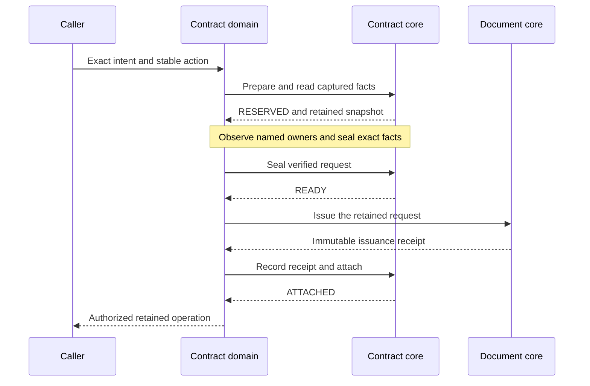

# Governed contract documents

The governed routes orchestrate the native contract document journal. They require an actual contract UUID, an explicit tenant, a stable action UUID, exact configuration/master pins, explicit product versions and retention intent. The domain does not create another journal or compensate by deleting issued evidence.

This guide describes the native orchestration and its deployment configuration. A deployment must provision trusted identity, current policy and legitimate credentials for every peer. Upstream onboarding, lending and insurance callers must supply actual contract IDs and the complete governed intent; their existing application or policy IDs cannot substitute for a contract ID. The supported facts and output profiles are defined below.

## Public routes

All routes start at `/api/v1/tenants/{tenantId}/contracts/{contractId}/governed-documents`.

| Method and suffix | Behavior |
| --- | --- |
| POST base | Reserve or observe the exact action, collect captured source identities, seal, issue, record and attach. Returns the currently authorized retained operation with HTTP200. |
| POST `/{actionId}/resume` | Resume from the native retained phase without inventing an action or reconstructing sealed facts. |
| GET `/{actionId}` | Read retained operation metadata under current authority. Private facts and sealed issue JSON are not returned by this view. |
| GET `/{actionId}/content` | Read attached, verified UTF-8 HTML bytes. Pending attachment is an explicit409. |

These routes bypass transport response caching. The native action ID supplies durable replay and intent conflict semantics. A repeated header cannot reuse a prior policy grant. Successful responses use `Cache-Control: no-store`. Content responses carry the immutable version ID and digest ETag only after content authorization and byte verification. The HTML download is an attachment with a restrictive content security policy.

## How an issuance progresses

The contract core retains the durable phase. Customer, product and master observations use their owning SDKs before sealing. The sequence below shows the journal and issuance boundaries; each peer call requires current authority and legitimate delegation.



These calls are separate local transactions. A timeout can follow a committed remote effect. Resume uses the original action and the core's retained phase to observe that outcome before advancing. It does not recreate facts, mint another action or delete issued evidence as compensation. Changing a source after attachment does not rewrite historical content; corrections require an explicitly authorized new operation.

An initial request contains only intent:

```json
{
  "actionId": "11111111-1111-4111-8111-111111111111",
  "expectedContractRevision": 7,
  "selection": {
    "documentPurpose": "CONTRACT_DOCUMENT",
    "productScope": "NONE",
    "channelCode": "WEB",
    "jurisdiction": "US",
    "localeCode": "en-US",
    "businessAtEpochMillis": 1792627200000
  },
  "expected": {
    "bindingId": "22222222-2222-4222-8222-222222222222",
    "bindingStateVersion": 1,
    "revisionId": "33333333-3333-4333-8333-333333333333",
    "sourceDigest": "aaaaaaaaaaaaaaaaaaaaaaaaaaaaaaaaaaaaaaaaaaaaaaaaaaaaaaaaaaaaaaaa"
  },
  "contractDocumentTypeId": "44444444-4444-4444-8444-444444444444",
  "productVersionReferences": [],
  "retention": {
    "policyCode": "CONTRACT_EVIDENCE",
    "policyVersion": "1",
    "retainUntilEpochMillis": 1981929600000
  },
  "displayName": "Synthetic contract evidence"
}
```

The example UUIDs and pins must be replaced by actual enrolled resources and exact observed revisions. `NONE` forbids a selection product ID; `EXACT` requires that ID and its explicit product version reference. Product references must equal the complete effective product set captured by core. `NONE` does not erase products present in the native contract snapshot. No latest version, locale, jurisdiction, product or tenant fallback exists.

Input accepts canonical lowercase UUID strings and exact integral JSON values. Duplicate/unknown fields, numeric-to-text coercion, fractional integer fields, trailing JSON, invalid Unicode, missing intent, oversized lists and unsupported enum values fail explicitly. The route-local body profile is64KiB UTF-8 after HTTP aggregation, depth16, string length1024 and numeric token length20. Core remains authoritative for state-dependent business validation. Epoch milliseconds preserve the native1900 through9999 range; UTC interpretation of legacy source timestamps is explicit.

## Trusted context and delegation

The new routes have a dedicated signature-verifying issuer/audience boundary. A final, lowest-priority chain denies all unmatched routes with403. A deployment's explicit legacy security chains must use a higher priority and their own validated authentication/current policy; the final denial is not a second permission authority. No unmatched route inherits anonymous access because the native scoped chain replaces framework auto-configuration. This intentionally changes default access for legacy routes and API discovery. Static generated OpenAPI remains available; an explicitly trusted deployment boundary is required for runtime discovery. Configure `firefly.contracts.documents.security.issuer`, `.audience` and `.jwk-set-uri`. Missing trust configuration denies access. Required expiration, timestamp, issuer, audience and signature validation use the shared Jafly resource-server facilities.

The protected integration requires `firefly.security.resource-server.strict-policy=true`; the owned application sets it explicitly. A false or missing flag denies before policy or peer effects, even if a project policy provider would otherwise grant. The qualified Jafly resource-server artifact must implement strict mode: no project rules and policy evaluation failures deny, and obligations remain visible for this guard to reject when unsupported. Compatibility-mode embedded RBAC behavior is not sufficient. An explicit project `PolicyDecisionPort` remains the single authority; no parallel policy alias is introduced.

Every orchestration phase requires a current Jafly `SecurityContextPort` principal and a granting `PolicyDecisionPort` decision with no unsupported obligations. Actions are `contracts.document.issue`, `.resume`, `.read`, `.collect-facts` and `.content.read`; the resource is `tenant/{tenantId}/CONTRACT/{contractId}`. Policy context includes the action, exact selection/pins/retention and retained digests. It excludes facts, names, bearer tokens and arbitrary request properties. Missing context/policy denies before peer effects. Body UUIDs and caller headers supply no actor or tenant authority.

A principal can act in its validated tenant, or use the explicit signed delegation authority `contracts.document.delegate` with a canonical bounded `contract_document_tenants` claim. An audience alone does not establish delegation. Current policy still decides each exact contract action.

Peer calls use `GovernedDocumentCredentialPort`. Its default implementation denies unless `firefly.contracts.documents.delegation.mode=validated-multi-audience` is explicitly selected. That mode relays only the current signature-validated JWT when its subject/issuer/tenant or signed delegation, finite expiration and configured peer audience agree with the current Jafly principal. Configure each audience under `firefly.contracts.documents.peers.{contracts,documents,customers,products,masters}.audience`. A deployment can supply a trusted credential adapter instead. This integration mode is not an assertion of service identity or live provider acceptance.

Governed peers require explicit URLs. Legacy `api-configuration` endpoint selectors and their localhost defaults do not configure these routes.

| Peer | Required endpoint property | Required audience property |
| --- | --- | --- |
| Contract journal | `firefly.contracts.documents.peers.contracts.base-url` | `firefly.contracts.documents.peers.contracts.audience` |
| Immutable document issuer | `firefly.contracts.documents.peers.documents.base-url` | `firefly.contracts.documents.peers.documents.audience` |
| Customer owner | `firefly.contracts.documents.peers.customers.base-url` | `firefly.contracts.documents.peers.customers.audience` |
| Product owner | `firefly.contracts.documents.peers.products.base-url` | `firefly.contracts.documents.peers.products.audience` |
| Global masters | `firefly.contracts.documents.peers.masters.base-url` | `firefly.contracts.documents.peers.masters.audience` |

Each URL must be an HTTPS origin without user information, query, fragment or path prefix. A single trailing slash is accepted. Missing or malformed URLs fail503 before owner HTTP. Private qualification can explicitly enable `firefly.contracts.documents.peers.<peer>.allow-loopback-http=true` for `http://127.0.0.1`, `http://localhost` or `http://[::1]` with a valid port. The default is false; non-loopback cleartext is rejected even when that flag is enabled. Existing legacy/signing endpoint selectors are unchanged.

Each call receives an isolated genuine generated client and a fresh expiring credential. No shared mutable authorization header or caller idempotency key is forwarded. Endpoint URLs come from trusted deployment configuration, never from templates, facts or request bodies.

## Authoritative facts and recovery

The only initial facts contract is `CONTRACT_DOCUMENT_V1`, version1. It is distinct from account-statement, loan-agreement, policy and other stationery-specific schemas. Core captures contract/party/line/term rows and owns their business meaning. The domain reads the exact retained snapshot, checks its digest, tenant, contract, action and source revision, then selects complete effective identity sets before foreign reads.

Customer SDK reads obtain the actual party and its matching individual or organization profile. Tenant and parent IDs must match. Individual display names use available given, middle, family and second family names in that order; at least given or family name is required, matching the customer owner's generic individual model. Given-only and family-only names are supported. Organizations require legal name. Tax IDs, birth dates, income and contact data are not copied into the enrichment projection. Product SDK reads require the actual product, tenant and explicitly named version with matching parent. Master SDK reads require the exact active contract role and contract document type by UUID. No discovery or by-code fallback is used.

Each observed source projection has a `CONTRACT_OBSERVATION_V1:<sha256>` fingerprint in `sourceVersion`. This is a digest of the minimal typed observation, including consumed identity/name/version/timestamps. It is not an immutable external revision, approval, ownership grant or distributed transaction. G3A retains the exact sealed meaning. A mutable source change after READY does not reopen sealed facts.

The source profile caps each captured list at100 and permits at most four concurrent source observations across all source families. Individual SDK calls have a4-second reactive budget; total collection has a30-second budget and orchestration a3-minute budget. These are reactive call budgets; CPU resource limits require deployment controls. A remote operation may complete after cancellation, so recovery retains the original action. The strict per-client codec rejects duplicate/trailing/unknown/coerced responses while retaining generated JavaTime handling and exact integer/decimal types. It bounds body aggregation to16MiB, depth64, names1024, strings2MiB and numeric tokens128.

Recovery observes the native phases:

1. RESERVED: observe retained private facts, collect the exact captured identities and seal typed enrichment. A failed collection does not partially seal. A nonempty captured `validationRules` list is explicitly outside this bounded profile and returns422 `GOVERNED_DOCUMENT_FACTS_UNSUPPORTED` before foreign source reads. The domain does not interpret those rules or financial term formats. The first request may already have created one native RESERVED journal to obtain that exact private snapshot; unsupported does not mean that nothing was persisted. No seal, issue, record or attach follows that result. Resume creates no new reservation, and current denial wins before facts access.

   The original action retains its original intent and authoritative snapshot. Do not strip business rules, rewrite the journal or delete the reservation as remediation. A separately qualified profile or a legitimate authoritative contract change may require a new action with its own current source and authorization checks.
2. READY: obtain the exact retained `sealedFactsJson` and `sealedIssueRequestJson`, verify their digests and action/profile, and send that same request through the genuine document SDK. Financial JSON strings remain opaque and byte-exact. They are not converted through a generic floating-point map. Integers above 2^53 and eighteen-decimal values are transport regression vectors; every value must still pass the native canonicalization, facts-schema and business-profile limits. An opaque high-scale string probe does not establish that arbitrary 128-scale raw JSON numbers are supported by the native issuer.
3. ISSUED_PENDING_ATTACHMENT: use the native verified record and attach operation. The domain does not recreate a receipt from mutable sources.
4. ATTACHED: return retained immutable evidence under current permission. Content read checks issuance/version/media/length/digest against native evidence and the actual returned UTF-8 bytes.

Lost issue, record or attachment responses are recovered by observing the retained phase and replaying the same action. No issued-document DELETE compensation exists. Conflicts require an explicit caller decision; the domain does not mint a replacement action or silently overwrite a sealed winner. New governed evidence cannot use the legacy signing path. This stage retains its immutable issuance/version references for a later qualified signing bridge; it does not implement that bridge. Existing supported legacy signing history remains separate.

## Legacy migration

Authorized calls reaching `POST /api/v1/kit-documents`, its legacy read route and `POST /api/v1/contracts/{contractId}/documents/generate` return409 `GOVERNED_DOCUMENT_INTENT_REQUIRED`. Authentication/security can deny before controller dispatch; the unmatched default is403. Historical success schemas remain in OpenAPI solely to preserve typed client compilation, not to advertise metadata-only success. Their old request fields cannot express governed authority and complete intent. The routes are deprecated and bypass transport caching; their explicit optional `X-Idempotency-Key` parameter remains only for existing generated-client compatibility. The old generate saga is inert and is not registered as a compensating saga.

The known upstream callers are onboarding's `IndividualOnboardingWorkflow` and `BusinessOnboardingWorkflow`, lending's `DomainLoanApplicationAdapter`, and insurance's `InsuranceJourneyService`. Their migration is a separate G3C integration stage. Party, application and policy IDs must never be guessed to be contract IDs. Ordinary contract document list/get routes remain separate association views and do not become governed content reads.

Errors distinguish malformed intent400, current-authority denial403, absent native action404, migration/intent/source/phase conflict409, unsupported native facts profile422 and unavailable/malformed/delegation peer failures502/503. Rejected operations do not imply provider acceptance, document issuance or attachment success.


## Java SDK content access and qualification boundary

Use the generated `GovernedContractDocumentsApi` for issue, resume and metadata. To consume immutable bytes, use `getGovernedContractDocumentContentWithResponseSpec(tenantId, contractId, actionId).bodyToMono(byte[].class)`. The generated convenience method has the standard binary `File` return type; this guide does not claim that its default reactive decoder materializes a local file. Retain the response version ID, digest and length when verifying an attachment, and do not reinterpret a metadata response as content.

The maintained private integration fixture launches seven actual executable applications: domain contracts, core contracts, document management, configuration, masters, customers and products. Six disposable PostgreSQL stores belong to the six state owners; the domain creates no second document journal. The domain uses its real RSA/JWKS authentication chain. An explicitly test-only credential SPI exchanges the current validated synthetic principal for credentials accepted by the copied peer fixtures. That fixture qualifies orchestration and native persistence, not a production token-exchange service or deployed identity-provider acceptance. Ordinary missing-policy/trust denial is verified separately from this explicit fixture.
